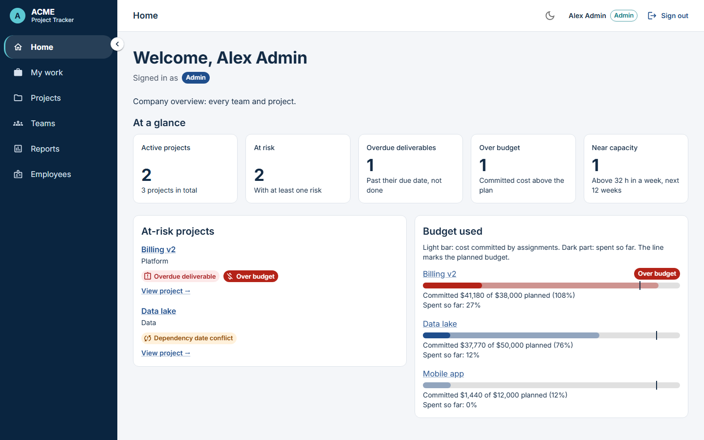
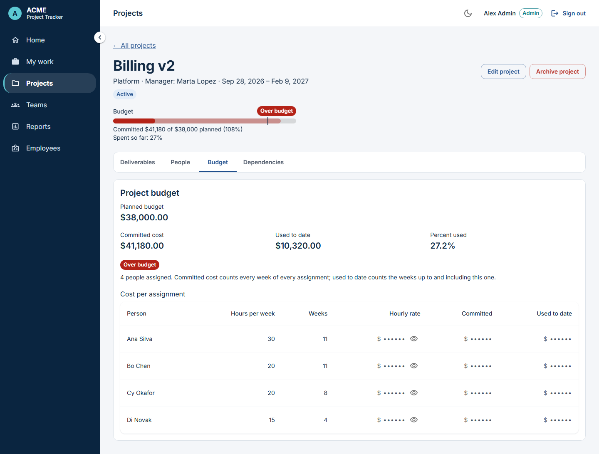
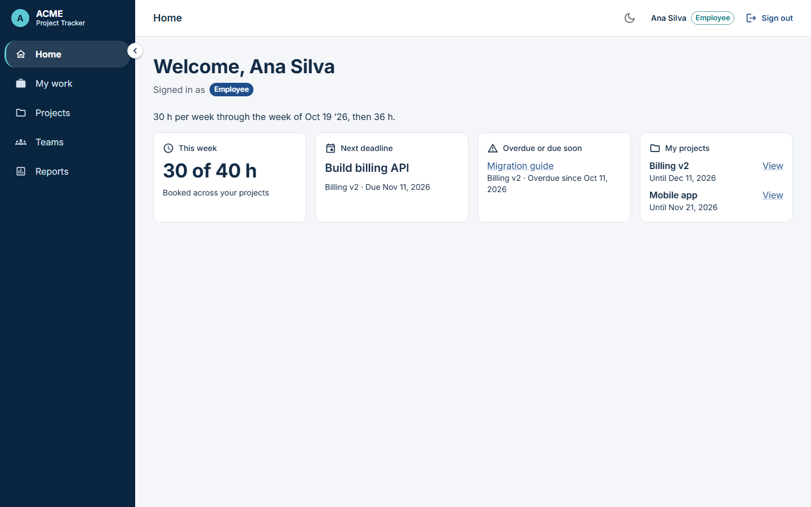
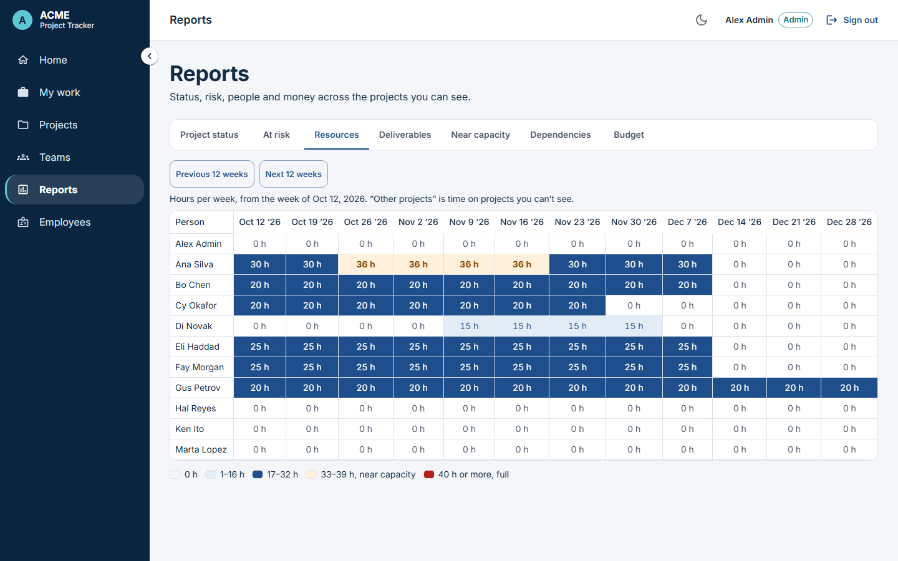
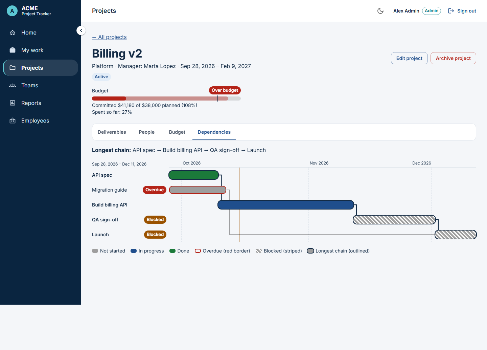
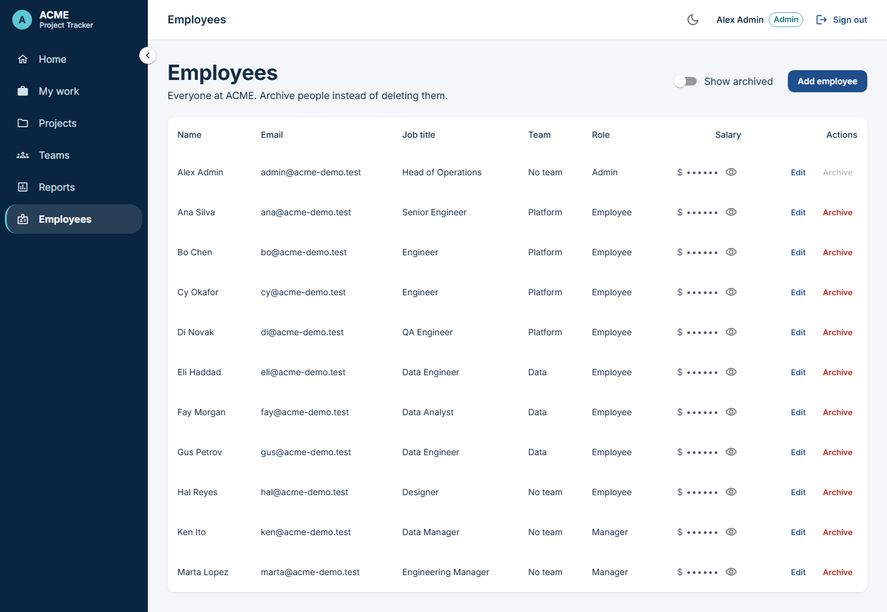

# ACME Project Tracker

I built this for the Citi coding workshop: a web app where ACME Inc. plans
projects, splits them into deliverables, assigns people by the hour, and keeps
an eye on budgets, without letting anyone see a colleague's pay.

## What this is

1. An admin sets up people, teams and their leads.
2. A manager (a team lead) creates projects for their team, breaks them into deliverables with dependencies, and assigns people for a number of hours per week.
3. The app refuses anything that would put a person over 40 hours in a week, or make the dependencies go round in a loop, and says which weeks or which deliverables.
4. Seven reports show progress, projects at risk, who is working where, overdue work, people near capacity, the dependency chain, and budget used against plan.
5. Salaries stay private: only an admin sees them, and group totals for fewer than 3 people are hidden from everyone else.

The demo runs locally on my laptop (see [How to run locally](#how-to-run-locally)).

Plainly, before you look further:
- **The cloud deploy was attempted and stopped at database creation**, because the AWS account hit its RDS
  quota (40 of 40 database clusters already in use in `us-east-2`). So the demo runs locally.
- **The audit log is written to the database but has no screen yet.**
- **The salary reveal is a display guard only.** An admin sees salaries and hourly rates masked until they
  click the eye button, and they mask again after 30 seconds or when the admin leaves the page. This stops
  someone reading them over the admin's shoulder. The API still sends these figures to an admin (and never
  to anyone else); the mask does not change what the server sends.
- A 5-minute walkthrough with exact clicks is in [docs/demo-script.md](./docs/demo-script.md).

## Screenshots

Taken with the seeded demo data on October 14, 2026 (`docs/screenshots/final/`).

| | |
|---|---|
|  |  |
| Admin Home. Every card is a link to the detail. | Project page. The budget bar says committed against planned and spent so far; per-person costs stay masked until the eye is clicked. |
|  |  |
| Employee Home: the coming weeks in one line, then cards that lead to My work and the projects. | Reports, Resources: hours per person per week. |
|  |  |
| The Dependencies tab: a timeline with the longest chain outlined. | Employees (admin): salaries masked until asked for. |

More: [sign-in](docs/screenshots/final/01-login.png), [manager Home](docs/screenshots/final/03-manager-home.png),
[Projects](docs/screenshots/final/05-projects.png), [phone](docs/screenshots/final/10-phone-home.png),
[dark mode](docs/screenshots/final/11-dark-home.png), [empty state for someone with no work](docs/screenshots/final/12-empty-state-hal.png),
[a manager's hidden small-group budget](docs/screenshots/final/13-manager-budget-hidden.png).
`npm run e2e` also saves every page for every demo account under `docs/screenshots/<account>/`.

## What it does, by role

Admin includes everything a manager can do, and a manager everything an employee can do.
The server checks the role on every request; hiding a button in the UI is only a courtesy.

| | Admin | Manager | Employee |
|---|---|---|---|
| Projects they see | All | Projects of the teams they lead | Projects they are assigned to |
| Change projects, deliverables, assignments | All | Their own teams' projects; they assign only people from their team | Read only |
| Salaries, hourly rates, per-person costs | Yes (the only role), masked until they click the eye | Never | Never |
| Budgets | All, in full | Project and team totals, hidden when fewer than 3 people are in the group | None |
| Employees page | Add, edit, archive, set team | Read only, no salaries | Not shown |
| Teams | Create, choose the lead, add or remove members, archive | See the teams they lead | See their own team |
| Reports | All 7 | All 7, limited to their teams | 4 of 7: project status, resources (their own hours), deliverables, dependencies |

Nothing is ever deleted: records are archived, and changes are written to an audit log.

## Architecture

Calls go in one direction on each side. A screen never talks to the database,
and only one layer on each side does the talking.

| Layer | Where | What it does |
|---|---|---|
| Page / component | `frontend/src/pages/`, `frontend/src/components/` | What you see (React + Material UI). |
| Hooks and session | `frontend/src/auth/`, `frontend/src/hooks/` | Who is signed in, the access token, loading and error state (`useLoad`). |
| Service | `frontend/src/services/*.js` | The only files that call `fetch`; one function per endpoint. |
| API contract | `docs/api-contract.md` | The agreed list of endpoints and JSON shapes. The source of truth. |
| Entry point | `backend/<service>/function.py` | The Lambda handler. |
| Routes | `backend/<service>/routes.py` | Reads the request and checks the caller's role. |
| Rules | `backend/<service>/services.py` | The business rules (40-hour limit, loops, budget hiding). |
| Repository | `backend/<service>/repository.py` | The only place SQL is written. |
| Shared kernel | `backend/common/` | Database, tokens, roles, validation, errors, audit, budget maths, week maths, migrations. |

```
coding-workshop-participant/
├─ backend/              one folder per backend service, each deployed as its own Lambda
│  ├─ auth/              sign in, refresh, sign out, "who am I"
│  ├─ employees/         people, roles and salaries
│  ├─ teams/             teams, leads, members, team budget
│  ├─ projects/          projects, deliverables, dependencies, project budget
│  ├─ allocations/       who works on what, hours per week, the 40-hour rule
│  ├─ reports/           the seven read-only reports
│  ├─ common/            the shared kernel, including migrations/ (001 to 006)
│  └─ _examples/         workshop starter code (not deployed)
├─ frontend/
│  ├─ src/               the React app (docs/frontend-guide.md explains every folder)
│  └─ e2e/               Playwright browser tests: a tour per demo account, then real flows
├─ scripts/              local tools: dev server, demo seed, admin seed, role smoke test, sync-common.sh
├─ docs/                 api-contract.md, frontend-guide.md, screenshots/, the workshop guides
├─ infra/                Terraform for AWS (from the workshop)
├─ bin/                  deploy and setup scripts (from the workshop)
└─ data/                 workshop extras for the data-engineering track (unused by the app)
```

## How to run locally

**Quick start** (after the one-time setup below): `scripts\start-demo.ps1` starts the database
container, creates the `acme_demo` database if it is missing, starts the backend and the frontend in
their own windows and opens http://localhost:3000. Add `-Reset` to put the demo data back as seeded.
It prints the demo e-mail addresses; the passwords are in `.env.local` under `DEMO_*`.

```powershell
scripts\start-demo.ps1 -Reset
```

**Prerequisites:** Node.js (I use 24), Python (I use 3.13) with a virtual
environment in `.venv` at the repo root, and PostgreSQL on this machine (I run
it in a Docker container named `acme-postgres`).

**1. Settings.** Create `.env.local` in the repo root (git ignores it). It needs these names:

| Variable | What it is |
|---|---|
| `POSTGRES_HOST`, `POSTGRES_PORT`, `POSTGRES_NAME`, `POSTGRES_USER`, `POSTGRES_PASS` | The local database. |
| `IS_LOCAL` | `true` locally (outside it, the database connection requires TLS). |
| `DEMO_ADMIN_PASSWORD`, `DEMO_MANAGER_PASSWORD`, `DEMO_EMPLOYEE_PASSWORD` | Passwords for the demo accounts, at least 12 characters each. |
| `SEED_EMAIL`, `SEED_NAME`, `SEED_JOB_TITLE`, `SEED_PASSWORD` | Optional, for `scripts/seed_admin.py` (it asks for any that are missing). |

**2. Python packages** (in the virtual environment): each service's
`requirements.txt` (`PyJWT`, `pg8000`), plus `pytest` and `pytest-cov` for the tests.

**3. Demo data.** Creates 1 admin, 2 managers, 8 employees, 2 teams, 3 projects,
deliverables and assignments. `--reset` starts it clean. It refuses any
database that isn't on localhost.

```powershell
.venv\Scripts\python.exe scripts\seed_demo.py --reset
```

**4. Backend.** Serves every service on http://localhost:3001. Pending database migrations run on the first request.

```powershell
.venv\Scripts\python.exe scripts\dev_server.py
```

**5. Frontend.** In a second terminal, then open http://localhost:3000:

```powershell
cd frontend
npm install
npm run dev
```

**6. Tests.**

```powershell
.venv\Scripts\python.exe -m pytest        # backend, with coverage (fails under 80%)
cd frontend
npm run coverage                          # frontend unit tests, with coverage (fails under 80%)
npm run lint
npm run build
```

**7. End-to-end tests.** Re-seeds the demo, starts both servers if they aren't
running, signs in as each demo account in a real browser, and saves screenshots to `docs/screenshots/`.

```powershell
cd frontend
npx playwright install chromium   # once
npm run e2e
```

**8. Role smoke test.** With the backend running on a seeded database, checks
the rules that matter most (salary privacy, group size, the 40-hour rule,
loops, visibility) through the API and prints one PASS or FAIL line per check.

```powershell
.venv\Scripts\python.exe scripts\smoke_roles.py
```

## How to deploy to AWS

**Honest status: the cloud demo is unverified.** I ran the workshop's deploy
scripts. They stopped at database creation because the AWS account hit its RDS
quota (40 of 40 database clusters already in use in `us-east-2`). Nothing after
that step has run in AWS, so the demo runs locally.

The steps, as the workshop scripts expect them:

1. `./scripts/sync-common.sh` copies `backend/common/` into every service folder. **Run it first, every time.** The copies are git-ignored, and a Lambda without them fails to start.
2. `./bin/deploy-backend.sh aws`: Terraform creates the network, the database, one Lambda per service folder (found by its `requirements.txt`) and the CloudFront routes `/api/<service>*`.
3. `./bin/deploy-frontend.sh` builds the frontend and uploads it to S3 behind CloudFront.

Deploy all six services together. The newer services need migrations 002 to 006,
and the first cold start of any service applies pending migrations (so the
database user needs the right to change tables).

Known blockers to check once a cluster is available:

- **sync-common.sh first** (above).
- **The database name.** Terraform names the database after the project with the dashes removed, and passes it to every Lambda as `POSTGRES_NAME`. Anything run by hand (a seed, a migration) must use the same name.
- **The `Authorization` header.** Every request carries `Authorization: Bearer <token>`. It must reach the Lambda through CloudFront unchanged. Not yet tested.
- **The API address.** The frontend calls `http://localhost:3001` unless `VITE_API_URL` is set when it is built. For AWS it has to point at the CloudFront address. (`frontend/.env.sample` still names old `REACT_APP_*` variables, which Vite ignores.)
- **Lambda memory.** Terraform gives each Lambda 128 MB. Password checking uses scrypt with up to 64 MiB, so sign-in may need more memory. Not measured.
- **No admin on a fresh cloud database.** There is no public way to create the first account. `scripts/seed_admin.py --allow-remote` can do it, but only from a machine that can reach the database inside its private network.

## Tests

Last full run on this laptop, October 14, 2026 (all from that run):

| Check | Result |
|---|---|
| Backend, `pytest` | 739 passed, 99.01% coverage |
| Frontend, `npm run coverage` (Vitest) | 425 passed in 35 files; 96.02% statements, 91.64% branches, 96.08% functions, 96.87% lines |
| `npm run lint` | No problems |
| `npm run build` | Built; main bundle 422.72 kB (137.47 kB gzipped) |
| End-to-end, Playwright (`e2e/01-pages`, `e2e/02-flows`) | 11 passed |
| Role smoke, `scripts/smoke_roles.py` | 11 passed, 0 failed |

Both coverage runs fail the build under 80%.

- **Backend:** pytest against a throwaway local database, per service and for the shared kernel.
- **Frontend:** Vitest + Testing Library. Pages run against a fake backend (`frontend/src/test/fakeApiServer.js`) that follows the API contract and its role rules. Every role, server refusals and phone widths are tested. One test checks that every status colour reaches a 4.5:1 contrast ratio in light and dark.
- **End-to-end:** Playwright tours every page as each demo account, checks that no salary, password or token appears for non-admins, then runs one real flow per role.
- **Role smoke:** `scripts/smoke_roles.py` against the running backend.

## Trade-offs I made

- **The token signing key is derived from the database password.** It saves managing another secret, but every service must share the same `POSTGRES_PASS`, and anyone who knows the database password could make tokens.
- **The refresh token is kept in the browser's `localStorage`.** The access token stays in memory only. A script-injection bug on the page could read the refresh token.
- **No per-IP rate limiting.** Repeated failed sign-ins are not slowed down by address.
- **Hiding small groups doesn't stop every leak.** Budgets of groups under 3 people are hidden, but comparing a team's total before and after one person joins or leaves can still reveal that person's pay.
- **One visibility rule for managers:** a manager sees only the projects of teams they lead. If an admin assigns them to another team's project, they can't see it, but the hours still count toward their 40.
- **Simple cost maths:** hourly rate = annual salary / 2080, using today's salary (no history). A partial week counts as a full week.
- **The shared kernel is copied, not packaged.** There is one source in `backend/common/`, copied into each Lambda by `sync-common.sh`.

## Known gaps

As of October 14, 2026:

- The audit log is written to the database, but no screen shows it yet.
- The salary reveal is a display guard only: the API still sends salaries and hourly rates to an admin.
- Lists are not paginated. The app is sized for demo data.
- The cloud deploy is unverified (see above). `package-lock.json` is git-ignored, so installs are not pinned.

## How to keep expanding the frontend

See [docs/frontend-guide.md](./docs/frontend-guide.md): how the frontend is
organised, and how to add a page, an API call, a component and a test.

## The original workshop brief

# Coding Workshop

The goal of this coding workshop is to enable and assess the hands-on skills
of participants through development of a practical technical solution that
solves a theoretical business problem.

## Getting Started

Navigate to [Coding Workshop - Main Guide](./docs/README.md) to get started.

## Coding Workshop Example

Coding workshop organizer(s) will provide instructions to follow by email. Here
below is a real example of requirements and expectations for participant(s):

### Requirements: Business Problem

Our company ACME Inc. is going through a massive organizational transformation
to become a more data-driven organization. Information about teams structure
and performance is currently scattered across multiple systems, making it
difficult to get a comprehensive view of team dynamics and achievements.

We are struggling to answer simple questions like:

* Who are the members of each team?
* Where are the teams located?
* What are the key achievements of each team on a monthly basis?
* How many teams have team leader not co-located with team members?
* How many teams have team leader as a non-direct staff?
* How many teams have non-direct staff to employees ratio above 20%?
* How many teams are reporting to an organization leader?

### Requirements: Technical Solution

As part of this transformation, we are looking to build a centralized team
management tool that will allow us to track team members, team locations,
monthly team achievements, as well as individual-level and team-level metadata.
Initial focus is to provide a self-service capability without any integrations
with other tools such as Employee Directory, Project Tracking, or Performance
Management.

The technical solution involves developing a stand-alone web application using
modern technologies. The application will have the following features:

* User authentication and authorization
* Role-based access control
* CRUD operations for individuals, teams, achievements and metadata
* Search and filter functionality
* Responsive design for mobile and desktop usage

### Requirements: Technology Stack

The following technologies are required to build the application:

* Frontend: HTML, CSS, React.js with React Responsive and Material UI Components
* Backend: Python
* Database: PostgreSQL

The following technologies are good to know, as they are used to manage and
deploy code:

* Version Control: Git, GitHub
* Infrastructure: Terraform
* Deployment Mode: Shell Scripts
* Deployment Target: AWS Serverless (e.g. S3, CloudFront, Lambda, RDS)

### Expectations: Value-Based Outcomes

By the end of the workshop, participants will have developed a functional
web application that meets the requirements outlined above. The application
will be deployed to a cloud environment and accessible via a web browser.
Participants will also gain hands-on experience with modern web development
technologies and best practices.

## Contributing

See the [CONTRIBUTING](./CONTRIBUTING.md) resource for more details.

## License

This library is licensed under the MIT-0 License.
See the [LICENSE](./LICENSE) resource for more details.

## Roadmap

See the
[open issues](https://github.com/citi/coding-workshop-participant/issues)
for a list of proposed roadmap features (and known issues).

## Security

See the
[Security Issue Notifications](./CONTRIBUTING.md#security-issue-notifications)
resource for more details.

## Authors

The following people have contributed to this workshop:

* Colin Heilman - [@heilmancs](https://github.com/heilmancs)
* Eugene Istrati - [@eistrati](https://github.com/eistrati)
* Isaiah Cornelius Smith - [@corneliusmith](https://github.com/corneliusmith)
* Juan Arevalo - [@jparevalo27](https://github.com/jparevalo27)
* Michael Annucci - [@michael-annucci](https://github.com/michael-annucci)

## Feedback

We'd love to hear your feedback! Please:

* ⭐ Star the repository if you find it helpful
* 🐛 Report issues on GitHub
* 💡 Suggest improvements
* 📝 Share your experience
